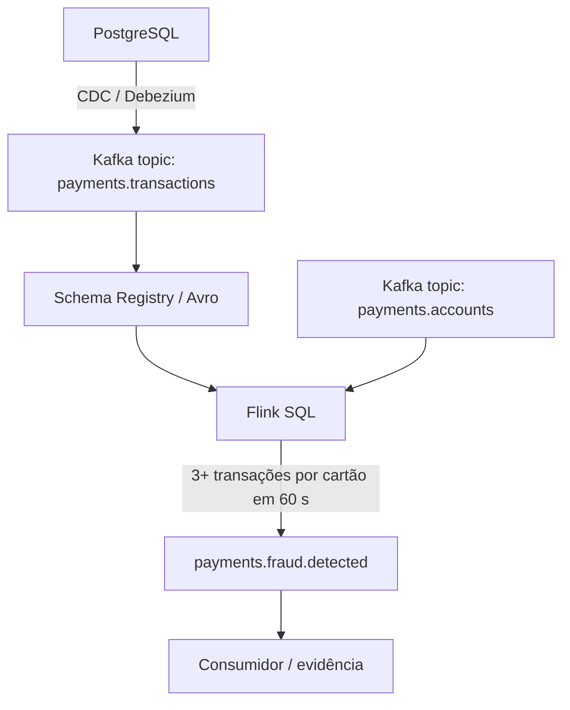

# Pipeline de Pagamentos em Tempo Real — DIO

Pipeline de demonstração para o desafio da DIO, baseado no PDF de entrega fornecido. O projeto demonstra a estrutura de ponta a ponta: PostgreSQL → CDC → Kafka/Confluent Cloud → Flink SQL → alerta de fraude.

> **Transparência da entrega:** os arquivos, scripts, dados sintéticos e documentação estão preparados. A execução real no Confluent Cloud, os prints, os testes de compatibilidade e o custo precisam ser preenchidos com resultados da sua conta. Este repositório não finge ter evidências de serviços que ainda não foram provisionados.

## Arquitetura



### Camadas

1. **Fundação:** ambiente, cluster, identidades e ACLs no Confluent Cloud.
2. **Contrato:** schemas Avro registrados no Schema Registry e testes de compatibilidade.
3. **Ingestão:** CDC do PostgreSQL, verificando INSERT, UPDATE e DELETE.
4. **Processamento:** Flink SQL para enriquecer transações e detectar velocidade anormal.
5. **Operação:** métricas, segurança, confiabilidade, custo e encerramento dos recursos.

## Conteúdo do repositório

- `database/`: esquema PostgreSQL e geração de dados sintéticos determinísticos.
- `schemas/`: schemas Avro de referência.
- `connectors/`: modelo de configuração para CDC; precisa ser adaptado ao conector e à conectividade da conta.
- `sql/`: consultas/tabelas de referência para Flink SQL.
- `scripts/`: comandos PowerShell para ambiente local.
- `evidencias/`: modelos para registrar evidências reais.
- `.env.example`: nomes de variáveis sem segredos.
- `docker-compose.yml`: PostgreSQL local com replicação lógica habilitada.

## Requisitos

- Windows 10/11
- Docker Desktop em execução
- VS Code (opcional, recomendado)
- Conta Confluent Cloud
- PowerShell
- Git para publicar no GitHub

## 1. Iniciar o PostgreSQL local

Extraia o ZIP, abra a pasta no VS Code e abra um terminal PowerShell nessa pasta.

```powershell
Copy-Item .env.example .env
docker compose up -d postgres
docker compose ps
```

Crie o esquema e os dados:

```powershell
Get-Content .\database\init.sql | docker compose exec -T postgres psql -U app_user -d payments
Get-Content .\database\seed.sql | docker compose exec -T postgres psql -U app_user -d payments
```

Confira os registros:

```powershell
docker compose exec postgres psql -U app_user -d payments -c "SELECT COUNT(*) AS total FROM customers;"
docker compose exec postgres psql -U app_user -d payments -c "SELECT COUNT(*) AS total FROM accounts;"
docker compose exec postgres psql -U app_user -d payments -c "SELECT COUNT(*) AS total FROM cards;"
docker compose exec postgres psql -U app_user -d payments -c "SELECT COUNT(*) AS total FROM merchants;"
docker compose exec postgres psql -U app_user -d payments -c "SELECT COUNT(*) AS total FROM transactions;"
```

Os totais esperados da carga sintética são 200 clientes, 240 contas, 320 cartões, 60 estabelecimentos e 2.000 transações. Isso confirma apenas a carga no PostgreSQL local — não comprova a execução do pipeline em nuvem.

Veja as três transações preparadas para o cenário de velocidade:

```powershell
docker compose exec postgres psql -U app_user -d payments -c "SELECT transaction_id, card_id, transaction_time, amount FROM transactions WHERE card_id = 1001 ORDER BY transaction_time LIMIT 5;"
```

## 2. Criar o ambiente Confluent Cloud

1. Acesse https://confluent.cloud/ e crie/acesse sua conta.
2. Antes de criar recursos, consulte os preços e créditos disponíveis.
3. Crie um Environment e um cluster Kafka em uma região disponível para sua conta.
4. Crie identidades separadas para produtor/conector e consumidor/processamento, usando privilégio mínimo.
5. Registre o nome, região, tipo de cluster e configurações utilizadas em `evidencias/01-fundacao.md`.

A disponibilidade e a cobrança de conectores gerenciados e Flink variam por conta/região/serviço. Confirme a disponibilidade na interface antes de seguir. Não cole API keys ou senhas no repositório.

### Conectividade do PostgreSQL

O banco local está publicado em `127.0.0.1:5432`, para uso apenas no computador. Um conector gerenciado na nuvem **não consegue acessar esse endereço local**. Para usar CDC gerenciado, escolha uma solução de conectividade segura e compatível com a oferta da conta (por exemplo, um PostgreSQL hospedado em endpoint acessível pela nuvem ou uma arquitetura de rede aprovada). Não exponha seu computador diretamente à internet sem firewall, TLS e autenticação adequada.

## 3. Contrato Avro

Os schemas de referência estão em `schemas/`. Revise o contrato de acordo com o envelope CDC e o formato efetivamente emitido pelo conector escolhido antes de registrá-los.

Teste de evolução recomendado:
- adicionar um campo opcional com `default` e confirmar compatibilidade BACKWARD;
- remover um campo obrigatório e confirmar que a alteração é rejeitada;
- guardar as saídas reais dos testes em `evidencias/02-schemas.md`.

Valores monetários usam `bytes` com logical type `decimal` no schema de transação.

## 4. CDC

O modelo de `connectors/postgres-cdc.example.json` é uma referência de configuração, não um arquivo pronto para enviar sem revisão. Substitua os placeholders usando o formulário/documentação do conector disponível na sua conta. Configure usuário dedicado, menor privilégio, publication/replication slot e conectividade.

Teste e registre:
- INSERT (`op=c`);
- UPDATE (`op=u`);
- DELETE (`op=d`) e tombstone, quando aplicável;
- `before` e `after` de acordo com a configuração de replica identity;
- heartbeat e monitoramento de WAL/replication slot.

Os exemplos de eventos em `evidencias/` não são preenchidos automaticamente: adicione apenas envelopes capturados do seu pipeline.

## 5. Processamento com Flink SQL

Os arquivos em `sql/` descrevem o contrato esperado, mas devem ser ajustados aos nomes de tópicos, schemas, formatos CDC e sintaxe suportada pelo Flink SQL da conta. Não execute sem validar esses detalhes.

Regra de velocidade: emitir um alerta quando o mesmo `card_id` apresentar três ou mais transações em uma janela de 60 segundos. Valide a regra com eventos que chegam durante a execução; dados antigos carregados no banco podem não produzir o mesmo resultado em todas as estratégias de janela.

Registre no `evidencias/04-fraude.md` as três transações observadas e o alerta correspondente no tópico de saída.

## 6. Operação e custos

Preencha `evidencias/05-operacao.md` com:
- pico de bytes recebidos e lag por grupo, quando disponível;
- relação de identidade → ACL → justificativa;
- custo real consultado no billing da conta e período medido;
- pontos de falha e estratégia de recuperação;
- confirmação de que os recursos foram removidos.

Não declare custo zero sem consultar o billing. Não inclua credenciais nem identificadores secretos nas capturas.

## 7. Encerrar recursos

Parar e remover o PostgreSQL local:

```powershell
docker compose down
```

Remover também os dados persistidos localmente:

```powershell
docker compose down -v
```

O segundo comando apaga o volume do banco local. Isso não remove recursos do Confluent Cloud. Faça o teardown dos recursos de nuvem na interface/CLI e confira as listas após a remoção para evitar cobranças contínuas.

## 8. Publicar no GitHub

1. Crie um repositório público chamado `pipeline-pagamentos-dio`.
2. No terminal, dentro da pasta do projeto:

```powershell
git init
git add .
git status
```

**Antes do commit, confira que `.env` não aparece na lista de arquivos adicionados.** Depois:

```powershell
git commit -m "Adiciona pipeline de pagamentos em tempo real"
git branch -M main
git remote add origin https://github.com/SEU-USUARIO/pipeline-pagamentos-dio.git
git push -u origin main
```

Troque `SEU-USUARIO` pelo seu nome de usuário real do GitHub.

## Checklist de entrega

- [ ] Banco local sobe e a carga sintética foi conferida.
- [ ] Ambiente/cluster e ACLs foram criados e documentados.
- [ ] Schemas registrados e compatibilidade testada.
- [ ] CDC real demonstrou INSERT, UPDATE e DELETE.
- [ ] Flink emitiu alerta real para a regra de velocidade.
- [ ] Métricas, segurança, custo e teardown foram documentados.
- [ ] Não há segredos versionados.
- [ ] Repositório público contém README e arquivos necessários.
- [ ] Nenhuma evidência ou custo foi inventado.
